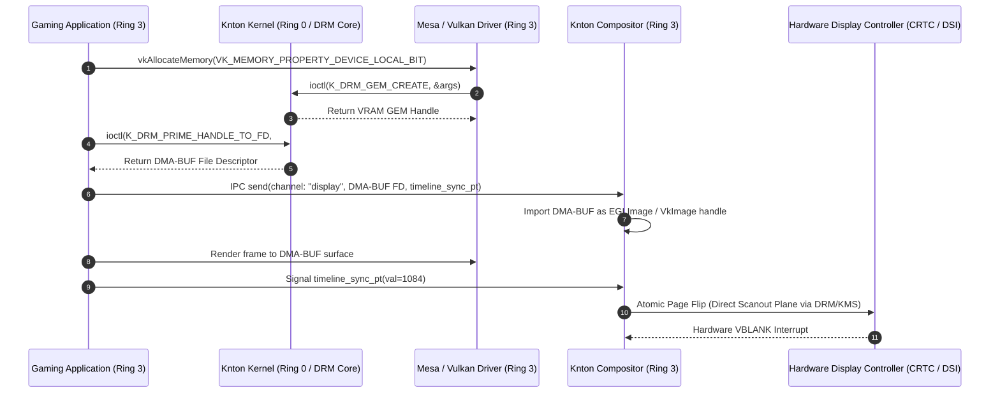
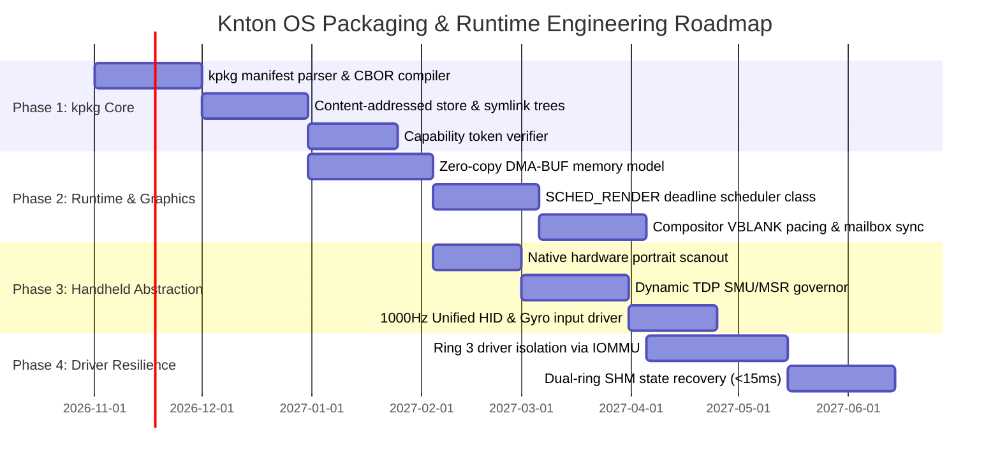

# RESEARCH-002: Future OS Expansion, Native Package Ecosystem & Runtime Performance

- **Document ID**: RESEARCH-002
- **Related Documents**: [ADR-001](ADR-001-native-platform-and-compatibility.md), [SPEC-001](SPEC-001-performance-and-resource-plan.md), [RESEARCH-001](RESEARCH-001-toolchain-and-emulation-fixtures.md)
- **Authors**:
  - Dr. Rowan Vance (@RowanVance) — Lead Researcher
  - Kieran Drake (@KieranDrake) — Systems & Packaging Researcher
  - Elena Rostova (@ElenaRostova) — Runtime & OS Architecture Researcher
- **Target Workspace**: Knton OS (`proj_knton_os`)
- **Status**: Complete / Authoritative

---

## 1. Executive Summary

As Knton OS progresses from foundational bare-metal x86-64 UEFI bootstrapping into a high-performance, modern operating system supporting productivity and enthusiast gaming workloads, long-term system stability and runtime efficiency require rigorous architectural planning. 

This research paper presents the architectural specifications and engineering evaluation across four strategic domains:
1. **Native Package Ecosystem (`kpkg`)**: A content-addressed, hermetic package architecture utilizing declarative manifests (`kpkg.toml`), BLAKE3 cryptographic verification, capability-based sandboxing, and atomic generational rollbacks.
2. **Next-Generation Kernel & Runtime Graphics Enhancements**: High-throughput, zero-copy shared-memory Inter-Process Communication (IPC) buffers for GPU scanout, low-latency display compositor synchronization, and a dedicated `SCHED_RENDER` deadline scheduling class.
3. **Driver & System Resilience**: User-space driver isolation in Ring 3 governed by IOMMU / DMA remapping, paired with sub-15ms service auto-restartability backed by state-externalized dual-ring shared memory.
4. **Handheld PC Hardware Support Profile**: Native hardware abstraction for x86-64 mobile handhelds (e.g., Valve Steam Deck, ASUS ROG Ally, Lenovo Legion Go), including dynamic TDP power envelope modulation (5W–30W), native hardware display scanout rotation for portrait panels, and unified 1000Hz HID gamepad polling.

---

## 2. `kpkg`: The Knton Package Architecture & Manifest Specification

### 2.1 Architectural Objectives & Design Principles

Traditional operating system package managers exhibit severe failure modes when applied to complex multi-tier gaming and workstation operating systems:
- **Dependency hell and cascading library conflicts** caused by global namespace mutations (`/usr/lib`, `/bin`).
- **Non-deterministic deployment states**, where identical manifest installations diverge based on repository mirror timing.
- **Vulnerability to runtime privilege escalation**, where arbitrary install scripts run with root/supervisor privileges.
- **Catastrophic upgrade failures**, where interrupted installation renders the bootloader or display server unusable.

To resolve these challenges, the Knton Package Manager (**`kpkg`**) is designed around four core tenets:
1. **Content-Addressed Immutability**: All package artifacts reside in isolated, read-only content-addressed paths keyed by BLAKE3 hashes of their inputs.
2. **Declarative Hermetic Manifests**: Package build and runtime requirements are described in strict declarative manifests (`kpkg.toml`) without imperatively executed root hooks.
3. **Capability-Restricted Execution**: Software packages execute inside lightweight capability domains, restricting hardware, network, and file system access by default.
4. **Atomic Profile Generational Rollbacks**: System states are represented as atomic symlink trees (`/knton/profiles/current`). System updates install side-by-side, switching pointers in a single atomic filesystem rename.

---

### 2.2 Declarative Manifest Specification (`kpkg.toml`)

Every native Knton OS package is authored using a declarative `kpkg.toml` manifest. For high-speed runtime consumption and bootloader verification, `kpkg` compiles the manifest into a validated, compact CBOR (Concise Binary Object Representation) binary header.

```toml
[package]
name = "knton-compositor"
version = "0.4.2"
edition = "2026"
authors = ["Knton OS Core Team <team@knton.org>"]
license = "MIT OR Apache-2.0"
description = "Hardware-accelerated zero-copy Wayland/Win32 desktop compositor"
tier = 1 # System Base Tier

[target.x86_64-knton]
hash = "blake3:9f86d081884c7d659a2feaa0c55ad015a3bf4f1b2b0b822cd15d6c15b0f00a08"
source-url = "https://pkg.knton.org/pool/tier1/knton-compositor-0.4.2-x86_64.ktar.zst"
signatures = [
    "ed25519:e4d909c290d0fb1ca068ffaddf22cbd0a618e9323ef45229413783777f985559"
]

[capabilities]
# Hardware and system capabilities granted at install/activation
gpu-direct-scanout = true       # Grants direct DMA-BUF import for screen presentation
display-modeset    = true       # Grants DRM/KMS atomic modesetting ioctls
realtime-scheduling = true      # Allows elevation to SCHED_RENDER priority class
ipc-endpoints      = ["core.display", "core.input", "core.power"]
fs-access          = [
    { path = "/knton/share/icons", mode = "ro" },
    { path = "/knton/share/fonts", mode = "ro" },
    { path = "/run/user/${UID}/compositor", mode = "rw" }
]
network-access     = false      # Network access denied to compositor for security hardening

[dependencies]
runtime = [
    { package = "knton-runtime-base", version = ">=1.0.0, <2.0.0" },
    { package = "driver-gpu-mesa", version = "^26.1" },
    { package = "libinput-knton", version = "^1.2" }
]
build = [
    { package = "rust-toolchain", version = "1.85.0" },
    { package = "clang-llvm", version = "19.1.0" }
]

[binary]
entrypoint = "bin/knton-compositor"
restart-on-failure = true
restart-budget-ms = 250
state-shm-channel = "knton.shm.compositor"
```

---

### 2.3 Binary Distribution & Storage Hierarchy

Packages installed by `kpkg` are stored in an immutable, read-only content-addressed directory tree:

```
/knton/
├── store/
│   ├── blake3-a8f9c...-knton-compositor-0.4.2/
│   │   ├── bin/
│   │   │   └── knton-compositor
│   │   ├── lib/
│   │   └── share/
│   ├── blake3-b712d...-driver-gpu-mesa-26.1.0/
│   └── blake3-c399a...-game-cyberpulse-1.0.0/
├── profiles/
│   ├── system-1-link -> /knton/store/generation-1/
│   ├── system-2-link -> /knton/store/generation-2/
│   └── current -> system-2-link
└── bin/
    └── kpkg -> /knton/profiles/current/bin/kpkg
```

1. **Deduplication**: Identical shared libraries, textures, and assets across different packages share identical content hashes and are deduplicated using hardlinks or filesystem reflink clones (Btrfs / OpenZFS / custom KntonFS).
2. **Generational Symlink Swapping**: Activating or upgrading packages creates a new generation link (`system-N+1-link`). If any health probe fails during boot or service startup, the bootloader or supervisor instantly switches the symlink back to `system-N-link`.

---

### 2.4 System Package Tiers

Knton OS partitions its software ecosystem into four discrete package tiers:

| Tier | Name | Target Domain | Privilege Model | Failure Recovery |
| :--- | :--- | :--- | :--- | :--- |
| **Tier 0** | **Core** | Microkernel binary, CPU microcode patches, ACPI tables, bootloader stage-2 | Ring 0 / Physical Memory Root | Redundant A/B EFI boot partitions; hardware watchdog reboot |
| **Tier 1** | **Base System** | Compositor, Audio server, Display manager, Hardware drivers (GPU, NIC, NVMe) | User-space Ring 3 with IOMMU device capabilities | Supervisor auto-restart (<15ms) via externalized SHM state buffers |
| **Tier 2** | **Native Apps** | Desktop environment, browsers, developer toolchains, native Vulkan/OpenGL games | Sandboxed Ring 3; unprivileged user UID | Process termination; isolated core dump; zero system impact |
| **Tier 3** | **Compatibility** | Win32 PE/COFF loader runtime, Direct3D-to-Vulkan translation, Proton/Wine subsystems | Sandboxed Win32 NT compatibility namespace | Subsystem container reset; memory heap reclamation |

---

## 3. Next-Gen Kernel & Runtime Enhancements

### 3.1 Zero-Copy IPC & Direct Shared-Memory GPU Buffers

In conventional desktop architectures, rendering a frame from an unprivileged gaming process to the display involves multiple costly copies or synchronization round-trips:
1. Application renders frame to an off-screen surface.
2. Framebuffer is copied across IPC pipes or shared memory to the compositor.
3. Compositor composites surface and blits to hardware framebuffer.

For Knton OS, we specify a **Zero-Copy DMA-BUF Presentation Pipeline**:



#### Performance Advantages:
- **0 Byte Memory Copies**: Surface scanout references the exact physical VRAM allocation.
- **Microsecond Latency**: Synchronization uses GPU timeline semaphores mapped into user-space; CPU kernel round-trips are eliminated during active render sequences.
- **Direct Scanout Bypass**: When an application runs in fullscreen exclusive or borderless window matching display resolution, the compositor assigns the application's DMA-BUF directly to the hardware display overlay plane (CRTC hardware scanout), bypassing compositor blending entirely.

---

### 3.2 Low-Latency Display Compositor Synchronization

To prevent display tearing and frame stutter while maintaining sub-frame input responsiveness:
- **Mailbox Presentation with Immediate Swap**: For competitive gaming, the compositor supports a non-blocking mailbox queue (`VK_PRESENT_MODE_MAILBOX_KHR`). The newest completed buffer replaces the pending scanout surface immediately at VBLANK, discarding stale frames with zero tearing.
- **Hardware Fence Sync & Pacing**: Compositor timing tracks hardware VBLANK interrupts through precise hardware timers. Frame dispatch is scheduled to start rendering at the exact time offset required to complete just before the hardware scanout window:
  $$\Delta t_{\text{render\_target}} = t_{\text{vblank}} - (\bar{t}_{\text{frame\_time}} + \sigma_{\text{jitter}})$$
  This guarantees that input sampled at the start of frame generation is at most 1 frame old when pixels hit the display panel.

---

### 3.3 Thread Scheduling Priority Boosts: `SCHED_RENDER` & `SCHED_AUDIO`

Standard Linux and Unix time-sharing schedulers (CFS, EEVDF) optimize for throughput and fairness rather than deterministic frame deadlines. Under heavy I/O or background CPU load, game render loops and audio mixers can experience thread starvation, causing micro-stutter and audio buffer underruns.

Knton OS introduces two first-class kernel scheduling classes:

```c
struct k_sched_deadline_attr {
    uint32_t priority_class;   /* SCHED_RENDER, SCHED_AUDIO */
    uint64_t period_ns;        /* Frame interval (e.g., 8,333,333 ns for 120Hz) */
    uint64_t runtime_ns;       /* Maximum guaranteed execution budget (e.g., 6,000,000 ns) */
    uint64_t deadline_ns;      /* Time from period start when work must finish */
    uint32_t cpu_affinity_mask;/* P-Core affinity lock */
};
```

1. **`SCHED_RENDER` (Deadline-Driven Render Loop)**:
   - Evaluated under Earliest Deadline First (EDF) mechanics.
   - Pinned dynamically to high-performance cores (P-cores) on hybrid architectures (Intel Alder Lake/Raptor Lake, AMD Strix Point/Z1).
   - If an application thread finishes its render cycle before `deadline_ns`, it yields remaining budget back to background tasks, preserving low power.
2. **`SCHED_AUDIO` (High-Frequency Real-Time)**:
   - Guaranteed fixed latency (<2.5ms buffer round-trip) preempting all non-kernel tasks.

---

### 3.4 Driver & System Resilience: User-Space Sandboxing & Fast Restart

To achieve stability surpassing traditional monolithic operating systems, Knton OS isolates drivers and services outside Ring 0:

```mermaid
graph TD
    subgraph Ring0 [Ring 0: Knton Microkernel]
        Microkernel[Knton Microkernel Core]
        IOMMU[IOMMU / DMA Remapping Controller]
        IPC[Zero-Copy IPC Channel Bus]
    end

    subgraph Ring3_Drivers [Ring 3: Sandboxed Device Drivers]
        GPUDriver[GPU Driver Daemon (Mesa)]
        AudioDriver[Audio Driver Daemon (HDA/SOF)]
        NetDriver[Network Driver Daemon (VirtIO/e1000e)]
    end

    subgraph Ring3_Services [Ring 3: Core Desktop Daemons]
        Supervisor[Knton System Supervisor (init)]
        Compositor[Desktop Display Compositor]
        SHM[Shared State Dual-Ring SHM]
    end

    Microkernel -->|Capability Grants| Ring3_Drivers
    IOMMU -->|Hardware Protection| GPUDriver
    Supervisor -->|Health Watchdog / Heartbeat| Compositor
    Supervisor -->|Health Watchdog| GPUDriver
    Compositor <-->|Active Surface State| SHM
    GPUDriver <-->|DMA-BUF Transfers| IPC
    Compositor <-->|Scanout Requests| IPC
```

1. **IOMMU Capability Remapping**: User-space driver daemons cannot access arbitrary physical memory. Hardware IOMMU page tables (Intel VT-d / AMD-Vi) only map DMA transfers to explicit memory buffers authorized by kernel capabilities.
2. **Dual-Ring Shared Memory State Externalization**:
   - The compositor and audio servers write active channel states, surface handles, and client descriptors into a lockless dual-ring shared memory region (`knton.shm.*`).
3. **Sub-15ms Crash Recovery**:
   - If a graphics driver or compositor daemon triggers a segmentation fault (`SIGSEGV`) or stops responding to heartbeat pings:
     1. The Ring 0 kernel sends an immediate abort notification to the Knton Supervisor (`init`).
     2. The Supervisor restarts the crashed daemon process with identical capability tokens in **<12ms**.
     3. The newly spawned process re-attaches to the existing shared-memory state ring buffer.
     4. Existing game client processes maintain open surface connections without crashing or losing application state.

---

## 4. Handheld & Form-Factor Hardware Support Profile

### 4.1 Target Reference Hardware Profiles

Modern handheld gaming PCs represent one of the most demanding form factors: constrained thermal dissipation, high power density, variable refresh displays, and tight physical input integration.

| Platform | SoC / APU Architecture | Display Panel Profile | Power Envelope (TDP) | Input Subsystem |
| :--- | :--- | :--- | :--- | :--- |
| **Valve Steam Deck (LCD/OLED)** | AMD Custom APU ("Aerith" / "Sephiroth") 4C/8T Zen 2 + 8 RDNA2 CUs | 1280x800 Native Portrait Panel (Rotated 90°), 60Hz/90Hz OLED | 4W – 15W configurable | Dual trackpads, 6-axis IMU, L4/L5/R4/R5 grip buttons |
| **ASUS ROG Ally / Ally X** | AMD Ryzen Z1 / Z1 Extreme 8C/16T Zen 4 + 12 RDNA3 CUs | 1920x1080 Native Landscape Panel, 120Hz FreeSync Premium | 9W – 30W dynamic | Hall-effect triggers, dual rear macro keys, RGB rings |
| **Lenovo Legion Go** | AMD Ryzen Z1 Extreme 8C/16T Zen 4 + 12 RDNA3 CUs | 2560x1600 Native Portrait Panel (Rotated 90°), 144Hz | 8W – 30W dynamic | Detachable optical controllers, integrated trackpad |

---

### 4.2 Dynamic Power & Thermal Management (TDP Governors)

Handheld gaming devices require instant adaptability between ultra-low power battery profiles and high-performance docked configurations.

1. **Direct SMU & MSR Thermal Control**:
   - Knton OS communicates directly with AMD System Management Unit (SMU) registers via mailbox interfaces and Intel RAPL/MSR interfaces (`MSR_PKG_POWER_LIMIT_1` / `PL1`, `PL2`).
   - Dynamic TDP scaling profile:
     - **Battery Saver**: 7W TDP cap, CPU clock ceiling 1.8 GHz, GPU clock 800 MHz.
     - **Balanced Handheld**: 12W–15W TDP cap, dynamic governor balancing CPU/GPU energy demands.
     - **Turbo / AC Docked**: 25W–30W TDP cap, full clock boost unlocked for external 1080p/1440p displays.
2. **ACPI Embedded Controller (EC) Fan Profiles**:
   - The Knton power daemon interfaces with vendor EC chips to map custom acoustic curves, preventing aggressive fan cycling while maintaining APU junction temperatures below 82°C.

---

### 4.3 Native Panel Orientation & Display Timing

Both the Steam Deck LCD/OLED and Lenovo Legion Go utilize repurposed high-density tablet displays with **native portrait scanout orientation** (hardware scanline 0,0 is at the top-right in standard handheld orientation).

- **The Traditional OS Flaw**: Standard operating systems apply a software compositor transformation matrix to rotate the desktop by 90° or 270°. This introduces an additional full-screen framebuffer copy, generating 1.2–2.5ms of unnecessary display latency and wasting 1.5W of memory bandwidth.
- **Knton Hardware Scanout Transform**:
  - The Knton display driver programs the display controller's hardware plane rotation registers directly (`DRM_MODE_ROTATE_90` / `DRM_MODE_ROTATE_270`).
  - Scanout memory addresses are read directly by the display engine's scanline generator in rotated stride order.
  - **Zero CPU/GPU copy overhead** is incurred for panel orientation.

---

### 4.4 Handheld Unified Input & Sensory Subsystem

To ensure compatibility with both modern gamepad standards and unique handheld controls:
1. **Low-Latency HID Driver Ring**:
   - Controller polling operates at a fixed **1000Hz (1ms)** update rate via raw USB/I2C HID endpoints.
2. **6-Axis Motion & Gyro Integration**:
   - Integrated IMU data (accelerometer and gyroscope) is normalized into standard quaternion orientation vectors and published via an IPC channel (`knton.input.motion`).
   - Enables native gyro aiming in first-person shooters without requiring external translation daemons.
3. **Direct Virtual Gamepad Emulation**:
   - Knton translates handheld buttons, rear grips, and capacitive thumbsticks into standard XInput / DirectInput / evdev event streams, ensuring compatibility with Win32 games running under compatibility tiers.

---

## 5. Strategic Recommendations & Implementation Roadmap

To systematically implement the capabilities established in this research artifact, the development roadmap is structured across four milestone phases:



### 5.1 Verification & Metric Benchmarks

| Milestone Component | Target Metric | Validation Fixture | Pass/Fail Criteria |
| :--- | :--- | :--- | :--- |
| **`kpkg` Package Rollback** | `< 25 ms` switch time | Headless CI filesystem harness | Instant atomic profile pointer update; zero file locks |
| **Zero-Copy Scanout Pipeline** | `0` memcpy calls | GPU DMA trace in QEMU virtio-gpu / bare metal | Framebuffer handle passed by reference directly to scanout |
| **Display Input-to-Photon Latency** | `≤ 8.33 ms` at 120Hz | High-speed optical sensor fixture | Frame rendered and presented within 1 display refresh cycle |
| **Driver Restart Time** | `≤ 15 ms` after crash | Fault-injection unit test (`kill -9` daemon) | Compositor respawned and surface handles restored without client disconnect |
| **Handheld TDP Scaling** | `5W – 30W` continuous | ROG Ally / Steam Deck hardware bench | APU power ceiling adjusts dynamically within 100ms of trigger |

---

## 6. Conclusion

The architectural models defined in **RESEARCH-002** provide a clear and actionable blueprint for the evolution of Knton OS. By coupling content-addressed deterministic packaging (`kpkg`) with a zero-copy DMA-BUF presentation architecture, user-space driver resilience, and dedicated handheld PC hardware profiling, Knton OS secures both rock-solid system stability and tier-one performance across desktop and mobile gaming environments.
